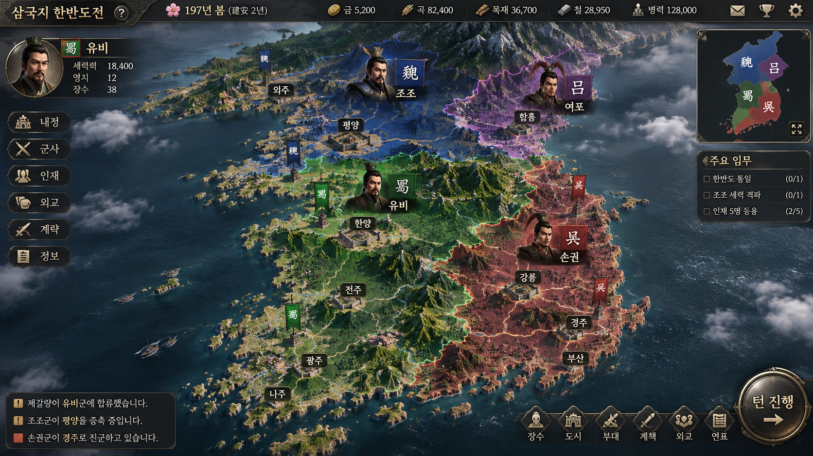

# 三國志 : 한반도 천하쟁패

삼국지의 영웅들이 한반도에 모여 천하통일을 겨루는 웹 전략 시뮬레이션 (오리지널 게임, 프로토타입 v2.7).



## 실행
```bash
npm install
npm run dev      # http://localhost:5173
npm test         # 테스트
npm run build    # dist/ 배포 빌드
```

## 문서
- [Game.md](Game.md) — 게임 대원칙
- [CLAUDE.md](CLAUDE.md) — 폴더 구조·개발 규칙·진행 현황
- [research.md](research.md) — 사전 리서치

## 배포
`main`에 푸시하면 GitHub Actions가 테스트·빌드 후 GitHub Pages에 올립니다.
(저장소 Settings → Pages → Source를 **GitHub Actions**로 한 번 설정해야 합니다.)
